  

  <!-- Troque o link abaixo pelo endereço do seu portfólio quando ele estiver publicado -->
  
  
  

---

### 👩‍💻 Sobre mim

Sou desenvolvedora backend na **Solinftec**, onde trabalho com **Java, Spring Boot e Kafka**, persistência em **Oracle** e **PostgreSQL/PostGIS** e aplicações rodando em **Kubernetes** com observabilidade na **AWS**. Estou me aprofundando em arquitetura de sistemas distribuídos, não só em como construir aplicações mas em como projetá-las para escalar, evoluir e se manter confiáveis.

  

### 🧰 Stack

  
  
  
  
  
   
  
  
  
  
  
   
  
  
  
  
  
  
  

### 🚀 Projetos em destaque

| Projeto | Sobre | Stack |
|---|---|---|
| [**AgendamentoAPI**](https://github.com/JavaPosTech/AgendamentoAPI) | Microsserviço de agendamento hospitalar com autenticação JWT e comunicação assíncrona | Java 21 · Spring Security · PostgreSQL |
| [**NotificacaoAPI**](https://github.com/JavaPosTech/NotificacaoAPI) | Consome eventos do RabbitMQ e notifica pacientes por e-mail, com retentativa automática | Spring Boot · RabbitMQ · Spring Retry |
| [**HistoricoAPI**](https://github.com/JavaPosTech/HistoricoAPI) | Histórico de consultas via GraphQL com 100% de cobertura de testes | Spring for GraphQL · JUnit 5 · JaCoCo |
| [**RestauranteAPI v2**](https://github.com/JavaPosTech/V2-RestauranteAPI) | Sistema de gestão de restaurantes reescrito com Clean Architecture | Spring Boot · Clean Architecture |
| [**ApiRestGo**](https://github.com/carolinebrunheti/ApiRestGo) | API REST de clientes em Go com router chi e PostgreSQL via Docker Compose | Go · chi · PostgreSQL · Docker |

Os projetos da FIAP foram desenvolvidos em grupo na pós-graduação.

### 🐍 Contribuições

<picture>
  <source media="(prefers-color-scheme: dark)" srcset="https://raw.githubusercontent.com/carolinebrunheti/carolinebrunheti/output/github-snake-dark.svg" />
  <source media="(prefers-color-scheme: light)" srcset="https://raw.githubusercontent.com/carolinebrunheti/carolinebrunheti/output/github-snake.svg" />
  
</picture>

---

  💜 Sempre aberta a trocar ideias sobre backend, arquitetura e sistemas distribuídos

